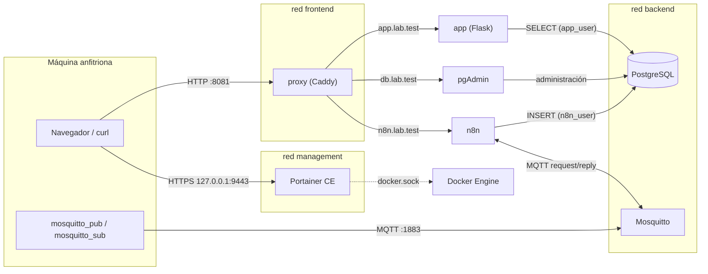

# TP Final Docker: plataforma de servicios integrados

Trabajo Práctico Integrador de Docker, ITES 2026.

## Integrantes

- Exequiel Bustos
- Facundo Neveu
- Juan Cruz Roldán
- Lucia Manzano
- Agustin Buss

## Objetivo y caso de uso

Plataforma contenerizada que recibe **lecturas de sensores simuladas** por dos vías (MQTT y HTTP), las procesa con n8n, las guarda en PostgreSQL y las muestra en una aplicación web. No se usa hardware real: los mensajes se simulan con `mosquitto_pub` y `curl`.

Cada lectura tiene dispositivo, tipo de medición, valor numérico, origen (`mqtt` o `http`) y fecha.

## Arquitectura



### Servicios

| Servicio | Función | Redes | Puerto publicado |
|---|---|---|---|
| `proxy` (Caddy) | Único punto de entrada HTTP | frontend | `8081` |
| `app` (Flask) | Muestra las lecturas en una tabla HTML | frontend, backend | ninguno |
| `n8n` | Workflows MQTT y webhook HTTP | frontend, backend | ninguno |
| `pgadmin` | Inspección de la base de datos | frontend, backend | ninguno |
| `postgres` | Persistencia | backend | ninguno |
| `mosquitto` | Broker MQTT | backend | `1883` |
| `portainer` | Administración y diagnóstico de Docker | management | `127.0.0.1:9443` |

### Redes

- **frontend:** conecta el proxy con las tres aplicaciones web.
- **backend:** red interna donde está la base de datos. El proxy **no** pertenece a esta red, por lo que no puede llegar a PostgreSQL ni a Mosquitto.
- **management:** aislada, solo para Portainer.

Los servicios se encuentran entre sí por **nombre de servicio** (por ejemplo `postgres`, `mosquitto`), nunca por dirección IP.

### Persistencia

Volúmenes con nombre: `postgres_data`, `pgadmin_data`, `n8n_data`, `mosquitto_data` y `portainer_data`.

## Decisiones técnicas

### Aplicación web: Python + Flask

Se eligió Flask por ser mínimo: una aplicación completa cabe en un solo archivo, tiene pocas dependencias (`flask`, `psycopg2-binary`, `gunicorn`) y produce una imagen Docker chica y simple. La aplicación consulta PostgreSQL con un usuario de solo lectura, y los datos de conexión llegan por variables de entorno.

### Proxy inverso: Caddy

Se eligió Caddy porque su configuración es un `Caddyfile` de pocas líneas, legible y fácil de explicar, y porque maneja solo los WebSockets que necesita el editor de n8n.

**Qué es un proxy inverso.** Es un servidor que recibe las solicitudes HTTP en nombre de otros servicios y las reenvía al correcto. El cliente solo conoce al proxy.

**Cómo identifica el destino.** Mira el encabezado `Host` de cada solicitud: `app.lab.test` va a la aplicación (`app:8000`), `db.lab.test` va a pgAdmin (`pgadmin:80`) y `n8n.lab.test` va a n8n (`n8n:5678`).

**Por qué se usa.** Da un único punto de entrada (un solo puerto publicado), evita exponer los puertos de cada aplicación y permite agregar servicios sin abrir puertos nuevos en la máquina anfitriona.

### Otras decisiones

- **Puerto 8081 en lugar de 8080.** En la PC de desarrollo el puerto 8080 estaba ocupado por Apache (`httpd`), y las solicitudes llegaban a ese servidor y no al proxy. Por eso todas las URLs llevan `:8081`. Si el puerto 8081 está ocupado en otra máquina, se cambia en `docker-compose.yml`, en el servicio `proxy`, y en las variables `WEBHOOK_URL` y `N8N_EDITOR_BASE_URL` de n8n.
- **`N8N_SECURE_COOKIE=false`.** Se trabaja con HTTP, no HTTPS. Sin esa variable, n8n no permite iniciar sesión.
- **Reinicio del proxy.** Si se modifica el `Caddyfile`, hay que ejecutar `docker compose restart proxy`, porque Compose no detecta cambios dentro de archivos montados.
- **Permisos de la base.** `n8n_user` puede leer e insertar. `app_user` solo puede leer, y un `DELETE` con ese usuario falla con `permission denied`.


## Requisitos previos

- **Docker** con el plugin **Docker Compose** (`docker compose version` debe funcionar).
  - Windows: Docker Desktop con backend WSL 2. Si falta la función "Virtual Machine Platform", ejecutar `wsl --install` en una terminal de administrador y reiniciar.
  - Linux: Docker Engine y el plugin de Compose.
- **Git** para clonar el repositorio.
- Los puertos **8081**, **1883** y **9443** libres en la máquina anfitriona.

Verificación:

```powershell
docker --version
docker compose version
docker run hello-world
```

## Instalación

### 1. Clonar el repositorio

```powershell
git clone https://github.com/AgusBuss/TP-FINAL-DOCKER-BUSTOS-NEVEU-ROLDAN-MANZANO-BUSS.git
cd TP-FINAL-DOCKER-BUSTOS-NEVEU-ROLDAN-MANZANO-BUSS
```

### 2. Configurar el archivo `.env`

El repositorio no incluye contraseñas. Hay que crear el archivo `.env` a partir de la plantilla:

```powershell
copy .env.example .env
```

(En Linux o Mac: `cp .env.example .env`.)

Abrir `.env` y reemplazar cada `cambiar` por una contraseña propia:

| Variable | Uso |
|---|---|
| `POSTGRES_USER`, `POSTGRES_PASSWORD`, `POSTGRES_DB` | Administrador y nombre de la base |
| `N8N_DB_USER`, `N8N_DB_PASSWORD` | Usuario de n8n (lectura e inserción) |
| `APP_DB_USER`, `APP_DB_PASSWORD` | Usuario de la aplicación web (solo lectura) |
| `PGADMIN_EMAIL`, `PGADMIN_PASSWORD` | Acceso a pgAdmin |

Recomendaciones:

- No usar símbolos como `$` o `'` en las contraseñas, porque pueden romper los scripts de inicialización.
- **No cambiar** los nombres `n8n_user` y `app_user`: están escritos en `postgres/02-init.sql`.
- El archivo `.env` está en `.gitignore` y no debe subirse al repositorio.

### 3. Resolución de nombres locales

El proxy enruta por nombre de host, por lo que hay que asociar los nombres a la máquina local agregando estas líneas al archivo `hosts`:

```
127.0.0.1 app.lab.test
127.0.0.1 db.lab.test
127.0.0.1 n8n.lab.test
```

- **Windows:** abrir el Bloc de notas **como administrador**, abrir `C:\Windows\System32\drivers\etc\hosts` (filtro "Todos los archivos"), agregar las líneas **sin `#` al inicio** y guardar.
- **Linux / Mac:** `sudo nano /etc/hosts`.

Alternativa sin editar `hosts` (solo para pruebas con curl):

```powershell
curl.exe --resolve app.lab.test:8081:127.0.0.1 http://app.lab.test:8081/lecturas
```

### 4. Construir e iniciar

```powershell
docker compose up -d --build
docker compose ps
```

Todos los servicios deben figurar como `Up`, y `postgres` como `healthy`. Si un servicio falla: `docker compose logs <servicio>`.

### 5. Detener

```powershell
docker compose stop      # apaga sin borrar nada
docker compose down      # elimina contenedores y redes; los volúmenes se conservan
```

> **No usar `docker compose down -v`**: elimina también los volúmenes, es decir, la base de datos y los workflows de n8n.

## Configuración inicial de n8n

La primera vez hay que crear la cuenta, las credenciales e importar los workflows.

1. Abrir http://n8n.lab.test:8081 y crear la cuenta de propietario (cada persona define la suya). Se pueden omitir las preguntas de personalización y la licencia.
2. **Credencial de PostgreSQL:** en el menú **+** → **Credential** → **Postgres**:
   - Host: `postgres`
   - Database: el valor de `POSTGRES_DB` (por defecto `plataforma`)
   - User: `n8n_user`
   - Password: el valor de `N8N_DB_PASSWORD`
   - Port: `5432`, SSL: `Disable`
3. **Credencial de MQTT:** **+** → **Credential** → **MQTT**:
   - Protocol: `mqtt`
   - Host: `mosquitto`
   - Port: `1883`
   - Usuario y contraseña vacíos, SSL desactivado
4. **Importar los workflows:** **+** → **Workflow**. Luego, en el menú `...` del workflow → **Import** → **From file**, y elegir cada archivo de `n8n/workflows/`:
   - `webhook.json`
   - `mqtt.json`
5. En cada workflow importado, abrir los nodos **Postgres** y **MQTT** (incluido el **MQTT Trigger**) y **seleccionar la credencial** creada en los pasos 2 y 3, porque la exportación no incluye contraseñas.
6. **Guardar** (Ctrl + S) y hacer clic en **Publish** en ambos workflows. Mientras no estén publicados, el webhook de producción y el trigger MQTT no responden.

## Registrar el servidor en pgAdmin

1. Abrir http://db.lab.test:8081 e iniciar sesión con `PGADMIN_EMAIL` y `PGADMIN_PASSWORD`.
2. **Agregar un Nuevo Servidor**:
   - General → Nombre: `plataforma`
   - Conexión → Host: `postgres` (nombre del servicio, no `localhost`), Puerto: `5432`, Base de datos: `plataforma`, Usuario: `POSTGRES_USER`, Contraseña: `POSTGRES_PASSWORD`
3. Las tablas están en **Bases de datos → plataforma → Esquemas → public → Tablas → lecturas**.

## Portainer

1. Abrir https://localhost:9443 y aceptar la advertencia del certificado (es autofirmado).
2. Portainer pide un **setup token**, que se obtiene de los logs:
   ```powershell
   docker compose logs portainer --tail 30
   ```
3. Crear el usuario administrador (contraseña de al menos 12 caracteres) y omitir **Edge Compute**.
4. Entrar al entorno **local**. Si pasan unos minutos sin crear el usuario, Portainer se bloquea; se resuelve con `docker compose restart portainer`.

## URLs y puertos

| Servicio | URL | Notas |
|---|---|---|
| Aplicación web | http://app.lab.test:8081 | Ruta `/lecturas` muestra la tabla |
| n8n | http://n8n.lab.test:8081 | Webhook: `POST /webhook/lecturas` |
| pgAdmin | http://db.lab.test:8081 | |
| Portainer | https://localhost:9443 | Solo accesible desde la propia máquina |
| Mosquitto (MQTT) | `localhost:1883` | Acceso anónimo |
| PostgreSQL | sin puerto publicado | Solo accesible dentro de la red Docker |


## Pruebas funcionales

Los comandos completos y reproducibles están en la carpeta `pruebas/`:

- [`pruebas/mqtt.md`](pruebas/mqtt.md): flujo MQTT request/reply.
- [`pruebas/webhook.md`](pruebas/webhook.md): webhook HTTP, con solicitud válida e inválida.

Todos los comandos se ejecutan desde la raíz del proyecto.

### Prueba 1: MQTT request/reply

Terminal 1, escucha la respuesta:

```powershell
docker compose exec mosquitto mosquitto_sub -h localhost -t "lab/g1/res/lecturas/req-001" -v
```

Terminal 2, publica la solicitud:

```powershell
Get-Content pruebas/mqtt.json -Raw | docker compose exec -T mosquitto mosquitto_pub -h localhost -t "lab/g1/req/lecturas.create" -s
```

Resultado esperado en la Terminal 1: una respuesta con el mismo `correlation_id` y el `id` del registro creado.

```
lab/g1/res/lecturas/req-001 {"ok":true,"correlation_id":"req-001","result":{"id":7,"status":"created"}}
```

Luego se verifica el registro en pgAdmin, en la aplicación web o con:

```powershell
docker compose exec postgres psql -U admin -d plataforma -c "SELECT * FROM lecturas ORDER BY id DESC LIMIT 5;"
```

El `correlation_id` es un identificador que el cliente elige y que n8n copia sin cambios a la respuesta. Permite relacionar cada respuesta con su solicitud cuando hay varios mensajes en circulación.

### Prueba 2: webhook HTTP

Solicitud válida (espera `201 Created`):

```powershell
curl.exe -i -X POST http://n8n.lab.test:8081/webhook/lecturas -H "Content-Type: application/json" -d "@pruebas/valida.json"
```

Solicitud inválida (espera `400 Bad Request`):

```powershell
curl.exe -i -X POST http://n8n.lab.test:8081/webhook/lecturas -H "Content-Type: application/json" -d "@pruebas/invalida.json"
```

El registro creado debe verse en pgAdmin y en http://app.lab.test:8081/lecturas con origen `http`.

### Prueba 3: proxy inverso

Abrir en el navegador, con el mismo puerto `8081`:

- http://app.lab.test:8081 → aplicación web
- http://db.lab.test:8081 → pantalla de inicio de sesión de pgAdmin
- http://n8n.lab.test:8081 → editor de n8n

Comprobación por línea de comandos: la respuesta de pgAdmin incluye el encabezado `Via: 1.1 Caddy`, que confirma que pasó por el proxy.

```powershell
curl.exe -i http://db.lab.test:8081/
```

Reglas de enrutamiento (`proxy/Caddyfile`):

| Nombre de host | Destino |
|---|---|
| `app.lab.test` | `app:8000` |
| `db.lab.test` | `pgadmin:80` |
| `n8n.lab.test` | `n8n:5678` |

Los servicios de destino no publican puertos HTTP en la máquina anfitriona.

### Prueba 4: persistencia

1. Verificar que hay registros en http://app.lab.test:8081/lecturas.
2. Destruir y recrear los contenedores **sin borrar volúmenes**:

   ```powershell
   docker compose down
   docker compose up -d
   ```

3. Esperar unos 30 segundos (n8n y pgAdmin tardan en arrancar) y volver a abrir http://app.lab.test:8081/lecturas. Los registros deben seguir ahí, con sus fechas originales.

Los datos viven en los volúmenes con nombre, no dentro de los contenedores, por lo que sobreviven a la eliminación de estos.

### Prueba 5: administración y diagnóstico

Por terminal:

```powershell
docker compose ps
docker compose logs n8n --tail 20
docker compose logs postgres --tail 20
```

Desde Portainer (https://localhost:9443), entorno **local**:

- **Containers:** los siete contenedores del proyecto, con su estado.
- Ícono de documento de cada fila (**Logs**): registros del contenedor.
- **Networks:** `proyecto-final_backend` contiene `postgres`, `pgadmin`, `app`, `mosquitto` y `n8n`; el proxy no está en esa red.
- **Volumes:** los cinco volúmenes del proyecto.

Para diagnosticar un error de conexión entre n8n y PostgreSQL: revisar `docker compose ps` (que `postgres` esté `healthy`), los logs de `postgres` y de `n8n`, y la credencial en n8n (host `postgres`, usuario `n8n_user`).

## Problemas conocidos

- **Puerto 8080 ocupado:** si otro programa (por ejemplo Apache) usa el 8080, las solicitudes llegan a ese programa y no al proxy. Por eso se usa el 8081. Se puede ver quién ocupa un puerto con `netstat -ano | findstr :8080`.
- **Workflows sin publicar:** guardar en n8n no alcanza. Si el webhook devuelve `404` o el trigger MQTT no responde, hay que hacer clic en **Publish**. Lo mismo después de cualquier cambio en un workflow.
- **Datos del trigger MQTT:** con las opciones *JSON Parse Body* y *Only Message*, el nodo MQTT Trigger entrega el mensaje dentro de una lista. Por eso las expresiones del workflow leen `$json[0]` y no `$json`.
- **Scripts de inicialización de PostgreSQL:** los archivos de `postgres/` solo se ejecutan la primera vez, cuando el volumen está vacío. Si se modifican, hay que borrar el volumen (`docker compose down -v`, que elimina todos los datos) para que se ejecuten de nuevo.
- **Finales de línea:** `postgres/01-roles.sh` debe tener finales de línea LF. El archivo `.gitattributes` lo fuerza al clonar en Windows.
- **Números de `id` salteados:** cuando un `INSERT` falla, la secuencia de PostgreSQL igualmente avanza, por lo que pueden faltar ids. Es el comportamiento normal de la base.
- **Cambios en el `Caddyfile`:** requieren `docker compose restart proxy`.
- **Respuestas MQTT de error:** el workflow MQTT descarta en silencio los mensajes inválidos y no publica una respuesta de error. Es una mejora pendiente (actividad opcional del enunciado).
- **MQTT sin autenticación:** Mosquitto acepta clientes anónimos (`allow_anonymous true`). Es adecuado para el entorno de laboratorio, pero no para producción.
- **Certificado de Portainer:** es autofirmado, por lo que el navegador muestra una advertencia que hay que aceptar.

## Estructura del repositorio

```
.
├── docker-compose.yml
├── .env.example
├── .gitignore
├── .gitattributes
├── README.md
├── app/
│   ├── Dockerfile
│   ├── .dockerignore
│   ├── app.py
│   └── requirements.txt
├── proxy/
│   └── Caddyfile
├── postgres/
│   ├── 01-roles.sh
│   └── 02-init.sql
├── mosquitto/
│   └── mosquitto.conf
├── n8n/
│   └── workflows/
│       ├── mqtt.json
│       └── webhook.json
└── pruebas/
    ├── mqtt.md
    ├── mqtt.json
    ├── webhook.md
    ├── valida.json
    └── invalida.json
```